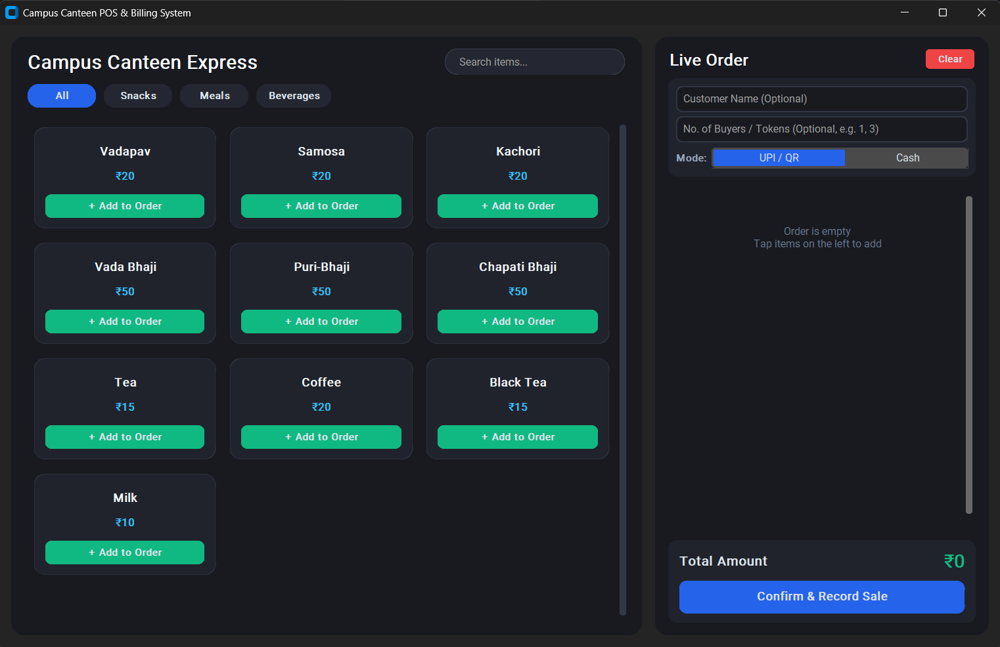

# 🍽️ Campus Canteen POS & Billing System

A desktop-based Point of Sale (POS) and billing application developed using Python and CustomTkinter to simplify order processing and sales management in a college canteen.

The application provides an interactive food menu, real-time cart calculations, order checkout, persistent menu storage, and an admin dashboard for managing items and viewing sales statistics.

## ✨ Features

- **Interactive Menu:** Browse canteen items displayed in a card-based layout.
- **Search & Categories:** Search for items and filter them by Snacks, Meals, and Beverages.
- **Live Shopping Cart:** Add items, adjust quantities, remove items, and calculate totals automatically.
- **Order Checkout:** Record orders with automatically generated order IDs and timestamps.
- **Customer Details:** Optionally enter the customer name and number of buyers or tokens.
- **Payment Mode Selection:** Record payments using UPI / QR or Cash.
- **Admin Dashboard:** Access menu management and sales analytics through the admin panel.
- **Menu Management:** Add new dishes, edit item details, update prices, change categories, and delete items.
- **Item Photo Management:** Upload or remove food images for menu items.
- **Persistent Storage:** Store menu data in JSON and maintain sales records in CSV format.
- **Sales Analytics:** View lifetime order count and total recorded revenue.
- **Dark UI:** A dark-themed desktop interface built with CustomTkinter.

--- 
<p>
  
</p>

## 🛠️ Tech Stack

- **Language:** Python
- **GUI Framework:** CustomTkinter
- **Image Processing:** Pillow (PIL)
- **Data Storage:** JSON and CSV
- **Standard Libraries:** `tkinter`, `csv`, `json`, `os`, `shutil`, `time`, and `datetime`

## 📂 Project Structure

```text
CanteenBillingSystem/
├── main.py
├── canteen_data/
│   ├── menu_items.json
│   ├── canteen_sales.csv
│   └── item_images/
├── README.md
├── LICENSE
└── .gitignore
```

The `main.py` filename is an example; replace it with your actual Python filename if different.

The `canteen_data/` directory and its files are created automatically when the application initializes or saves data.

## 🚀 Getting Started

### Prerequisites

- Python installed on your computer
- `pip` package manager

### 1. Clone the repository

```bash
git clone https://github.com/Rudra1725/CanteenBillingSystem.git
cd CanteenBillingSystem
```

### 2. Install dependencies

```bash
python -m pip install customtkinter Pillow
```

### 3. Run the application

```bash
python main.py
```

Replace `main.py` with your actual script filename if necessary.

## 🔐 Admin Panel

The admin panel provides access to menu management and sales analytics.

**How to open it:** Click the application title three times within approximately 1.5 seconds.

From the admin panel, you can:

- Add new menu items.
- Edit item names, prices, and categories.
- Upload or remove item photos.
- Delete menu items.
- View total recorded orders and lifetime revenue.

## 💾 Data Storage

| File or directory | Purpose |
|---|---|
| `menu_items.json` | Stores menu items, prices, categories, and image paths |
| `canteen_sales.csv` | Records order IDs, timestamps, customer details, items, totals, and payment modes |
| `item_images/` | Stores uploaded food images |

Menu changes persist between application sessions. Completed orders are appended to the CSV sales file.

## ⚠️ Current Limitations

- Sales analytics display lifetime totals rather than date-wise reports.
- Payment mode is recorded, but payments are not processed through a payment gateway.
- Sales records are stored locally, without a cloud database or multi-user synchronization.
- The admin panel uses title-click access rather than password-based authentication.
- Menu image paths are stored locally, so moving the project may require updating image paths.

## 🎯 Project Objective

The goal of this project is to build a practical desktop application for college canteen billing, reduce manual order calculations, organize sales records, and simplify menu administration.

## 📄 License

This project is licensed under the MIT License. See the [LICENSE](LICENSE) file for details.
